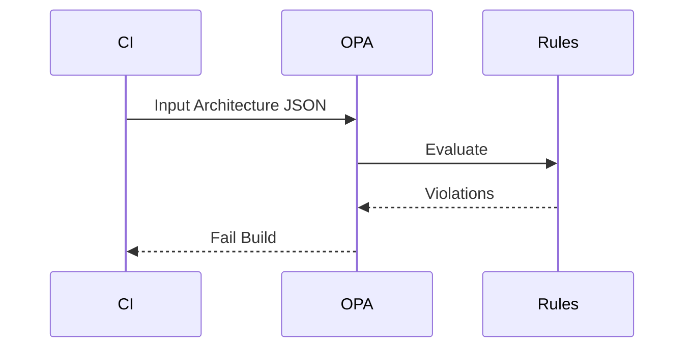
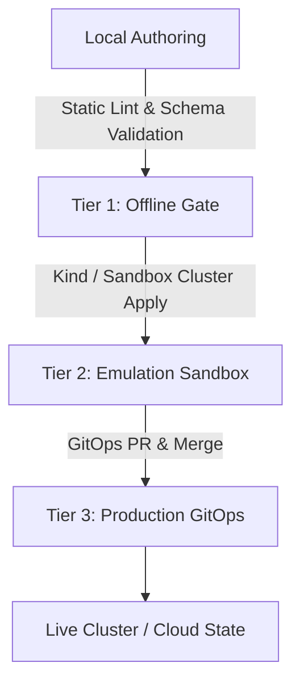

# opa-threat-modeling-library Architecture
> Maturity: Lab / Reference Implementation

## System Diagram
The following Mermaid.js sequence diagram maps the core workflow and interactions:

## Component Breakdown
- **Core Technology**: Rego, OPA
- **Design Paradigm**: Emphasizes high availability, fault tolerance, and security.

## Security & Scaling Considerations
- Strict boundary validations.
- Horizontal scalability achieved via stateless workers.
- Encrypted data at rest and in transit.

## Verification & Deployment Architecture (v0.2.0)

This repository follows a progressive verification architecture designed for zero-trust cloud native environments:

- **Tier 1 (Offline Validation):** Syntax validation, static policy checks (`opa test`, `kyverno test`, `terraform fmt -check`), and schema verification without cloud dependencies.
- **Tier 2 (Sandbox Emulation):** Automated testing against local Kind clusters or isolated development namespaces.
- **Tier 3 (Production GitOps):** Automated deployment via GitOps controllers (ArgoCD / Flux) or infrastructure pipelines with cryptographically signed release manifests and SPDX SBOMs.
